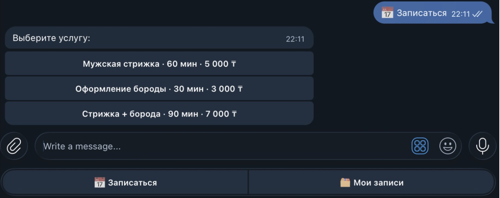
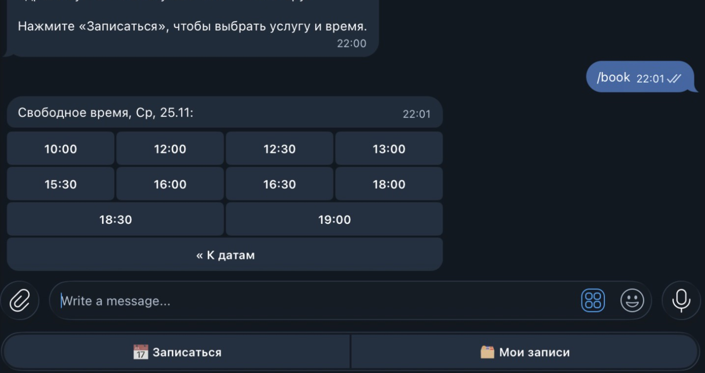
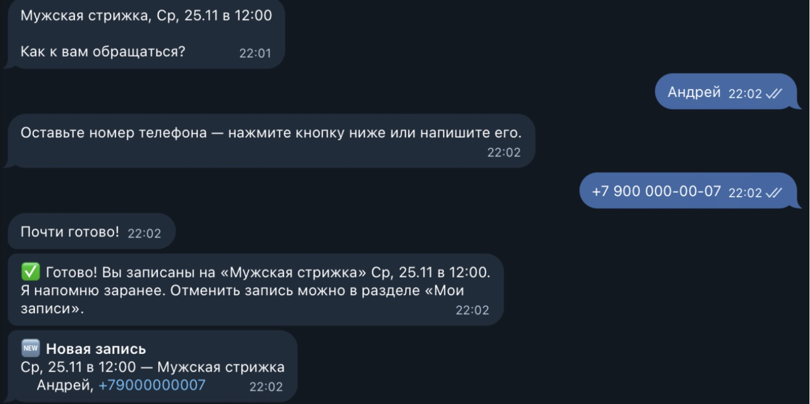
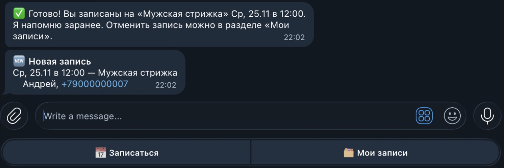
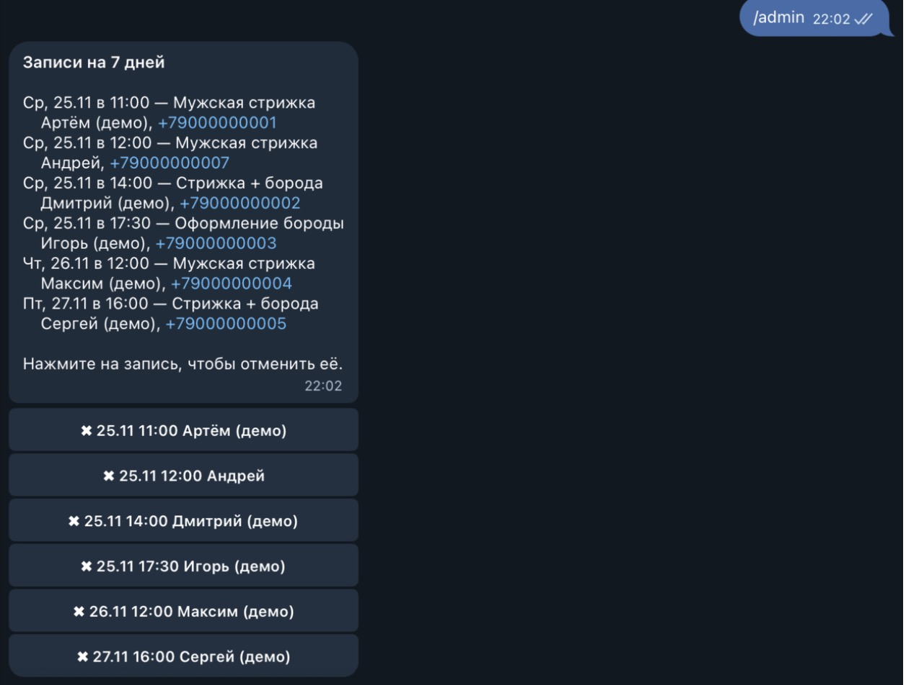

# 📅 Telegram-бот онлайн-записи для мастеров

Бот, который принимает записи вместо администратора — круглосуточно и без ошибок.
Подходит барберам, мастерам маникюра и бровей, массажистам, косметологам,
репетиторам и всем, кто работает по записи.

**Живое демо:** [@calacu_bot](https://t.me/calacu_bot) — запишитесь сами и посмотрите, как это работает.

<p>
  
  
  
</p>

## Что получает мастер

- **Больше записей.** Клиент записывается в два касания в любое время, даже ночью, пока вы спите.
- **Меньше неявок.** Бот сам напоминает клиенту о визите за 2 часа.
- **Никаких накладок.** Два клиента физически не могут занять одно время —
  даже если нажмут «Подтвердить» в одну секунду.
- **Всё под контролем.** О каждой новой записи и отмене приходит уведомление,
  команда `/admin` показывает расписание на неделю.
- **Не нужно переписываться.** Клиент сам видит свободное время и сам может отменить запись.

<p>
  
  
</p>

## Как это выглядит для клиента

1. Нажимает «📅 Записаться»
2. Выбирает услугу — видит цену и длительность
3. Выбирает дату — показываются только дни, где есть свободное время
4. Выбирает время из свободных окон
5. Оставляет имя и телефон (номер можно отправить одной кнопкой)
6. Подтверждает — и получает напоминание перед визитом

## Под ваш бизнес

Настраивается под вас: услуги и цены, рабочие часы, выходные, шаг записи,
на сколько дней вперёд открыта запись, тексты и тон общения.

Можно доработать:

| Доработка | Зачем |
|---|---|
| Несколько мастеров | Салон, где у каждого своё расписание |
| Выгрузка в Google Таблицы | Смотреть записи и статистику в привычной таблице |
| Предоплата через ЮKassa | Меньше неявок, деньги сразу на счёте |
| Отзывы после визита | Бот сам попросит оценку и отзыв |
| Рассылки клиентам | Акции, свободные окна, поздравления |

---

## Для разработчиков

**Стек:** Python 3.9+, aiogram 3, SQLite (aiosqlite), pytest.

### Запуск

1. Создайте бота у [@BotFather](https://t.me/BotFather) и узнайте свой id у [@userinfobot](https://t.me/userinfobot).
2. Установите зависимости и создайте файл настроек:

```bash
python3 -m venv .venv
.venv/bin/pip install -r requirements.txt
cp .env.example .env
```

3. Впишите в `.env` значения `BOT_TOKEN` и `ADMIN_IDS`, затем запустите:

```bash
.venv/bin/python -m bot
```

### Настройка

Расписание и услуги задаются в `bot/schedule.py`:

| Что | Константа |
|---|---|
| Услуги, длительность, цены | `SERVICES` |
| Рабочие часы | `WORK_START`, `WORK_END` |
| Выходные | `DAYS_OFF` |
| Шаг сетки времени | `SLOT_STEP_MIN` |
| На сколько дней вперёд запись | `BOOKING_HORIZON_DAYS` |
| Минимум до начала записи | `MIN_LEAD_MIN` |
| За сколько напоминать | `REMINDER_BEFORE_MIN` |

Все тексты бота — в `bot/texts.py`.

### Устройство

```
bot/
  __main__.py      запуск, сборка диспетчера
  config.py        чтение .env с проверкой значений
  schedule.py      услуги и расчёт свободных слотов (без Telegram)
  db.py            SQLite: создание, отмена, поиск записей
  validators.py    проверка имени и телефона
  texts.py         все тексты
  keyboards.py     кнопки
  notify.py        безопасная отправка сообщений
  reminders.py     фоновые напоминания
  handlers/
    client.py      сценарий клиента
    admin.py       команды мастера
tests/             31 тест, включая сквозной сценарий записи
```

Защита от двойной записи сделана транзакцией `BEGIN IMMEDIATE`:
проверка свободного времени и вставка записи выполняются атомарно.

### Тесты

```bash
.venv/bin/pip install -r requirements-dev.txt
.venv/bin/python -m pytest --cov=bot
```

### Ограничения

- Незавершённое оформление хранится в памяти (`MemoryStorage`) —
  при перезапуске клиенту нужно начать заново. Для продакшена — `RedisStorage`.
- Телефоны принимаются российские (+7).
- Одно расписание; несколько мастеров — доработка.
